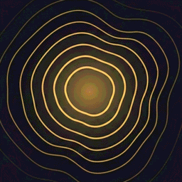
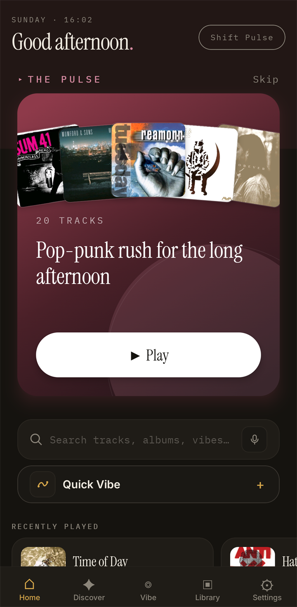
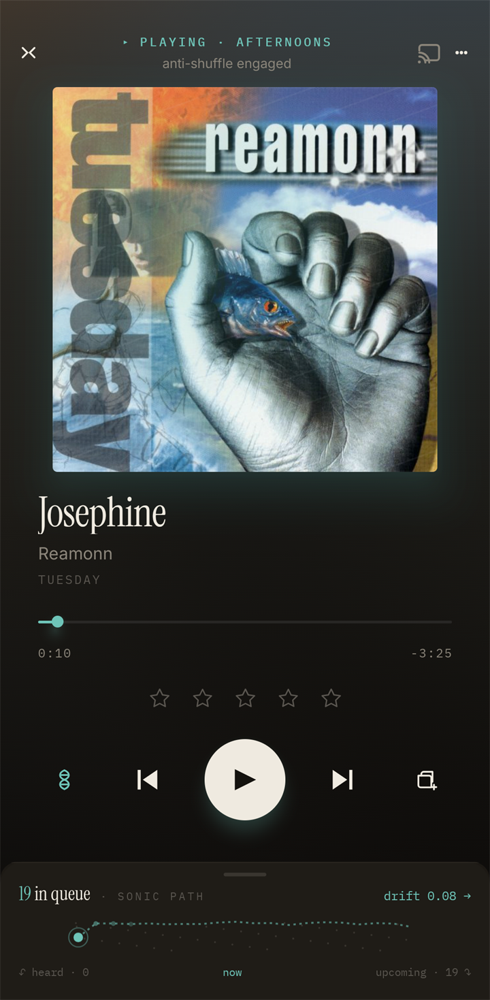
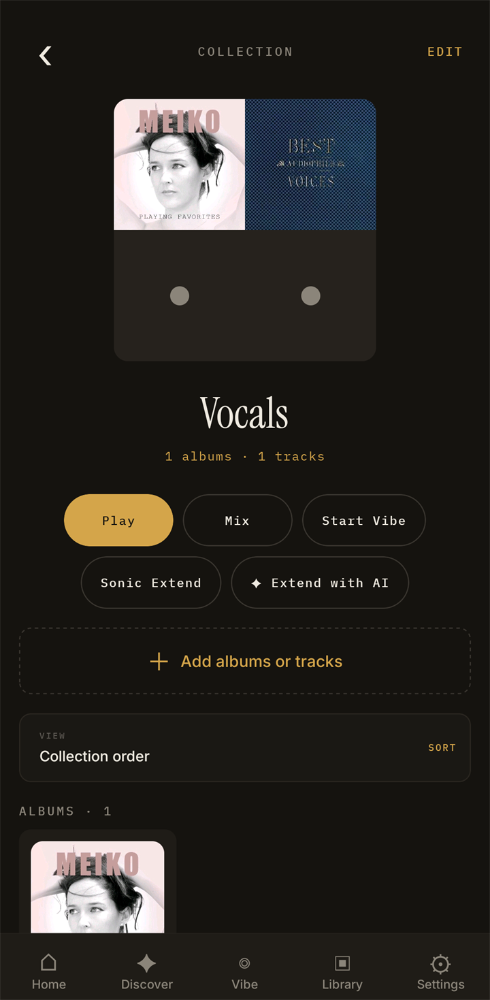
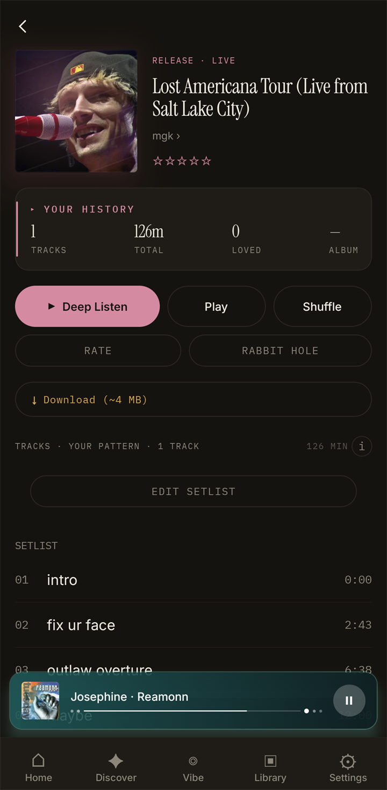

  

  <h1>Lumae</h1>

  
<strong>Your library, rediscovered by sound.</strong>

  

    An AudioMuse-AI-first music player for people who want more from the music
    they already own.
  

  
Android beta · iPhone TestFlight · Navidrome · AudioMuse-AI

  

    <a href="https://forms.gle/4MYsAvnMfVqAtvjC6"><strong>Join the beta</strong></a>
    ·
    <a href="#setup">Setup</a>
    ·
    <a href="PRIVACY.md">Privacy</a>
    ·
    <a href="https://github.com/rendyhd/lumae/issues">Give feedback</a>
  

---

Lumae turns a self-hosted Navidrome library into a personal sonic landscape:
daily discovery, intentional album listening, living Collections, similarity
trails, anti-shuffle queues, and saved Vibes shaped by the sound of your music.
It requires Navidrome, AudioMuse-AI, and the Lumae Analysis plugin.

> [!IMPORTANT]
> **Updating the current Android or iPhone beta:** install the latest native
> beta build for your platform—the latest Android beta build or TestFlight
> build—then open Lumae and leave it open for at least 20 seconds. Force-close
> the app and open it again. The current release requires both the latest native
> build and the downloaded OTA.

## See Lumae in action

| The Pulse                                                                                                                                    | Now Playing                                                                                                                   |
| -------------------------------------------------------------------------------------------------------------------------------------------- | ----------------------------------------------------------------------------------------------------------------------------- |
|                                                  |  |
| **Collections and extensions**                                                                                                               | **Live releases and setlists**                                                                                                |
|  |        |

<em>Captured from the current beta on a Pixel.</em>

## One library. Three ways in.

| Discover                                                                                                                 | Vibes & Collections                                                                                      | Deep Listen                                                                                                      |
| ------------------------------------------------------------------------------------------------------------------------ | -------------------------------------------------------------------------------------------------------- | ---------------------------------------------------------------------------------------------------------------- |
| Let **The Pulse**, Right Now, Rabbit Hole, Drift, and Sonic Bridge uncover forgotten corners and unexpected connections. | Turn words, tracks, albums, and playlists into saved listening shapes. Extend them sonically or with AI. | Play an album in order, stay with it, and finish with a rating ceremony that becomes part of your taste profile. |

## What is new

|                                                                                                                                                                                |                                                                                                                                                          |
| ------------------------------------------------------------------------------------------------------------------------------------------------------------------------------ | -------------------------------------------------------------------------------------------------------------------------------------------------------- |
| **Faster everywhere** Startup, browsing, search, navigation, queue building, and first-track playback have all had a major performance pass.                                | **Deeper caching** Artwork, catalogue data, tracks, screens, and discovery shelves appear immediately and refresh quietly in the background.          |
| **Native playback** Android and iOS now use native players with cache-ahead, loudness normalization, and artifact-free SmoothFade transitions.                              | **Reliable streaming scrubbing** OpenSubsonic range requests and `transcodeOffset` seeking fix scrubbing on streamed and transcoded Navidrome tracks. |
| **Living Collections** Combine albums and tracks, sync them through the Lumae Analysis plugin, manage them in a browser, or start a Vibe from them.                         | **Extend any idea** Sonic Extend and Extend with AI add library-grounded tracks to playlists and Collections.                                         |
| **AudioMuse-AI v3, safely** Lumae Analysis is required on every supported AudioMuse version; on v3 it keeps Navidrome's catalogue intact alongside deduplicated sonic data. | **Release intelligence** Automatic or manual release types, release-aware discographies, and timestamped navigation for long single-track live sets.  |

## At a glance

|                    | Current beta                                                      |
| ------------------ | ----------------------------------------------------------------- |
| **Platforms**      | Android and iPhone                                                |
| **Music server**   | Navidrome                                                         |
| **Sonic analysis** | AudioMuse-AI + required Lumae Analysis plugin                     |
| **Playback**       | Native Android and iOS engines                                    |
| **Discovery**      | Local-library recommendations, with optional AI assistance        |
| **Offline**        | Downloads, offline pins, Smart Downloads, and full-library mirror |
| **In the car**     | Android Auto; CarPlay planned                                     |

<strong>Explore the full feature set</strong>

### Discovery

- **The Pulse** and **Right Now** adapt to time, taste, and recent listening.
- **Discover Chat** turns a natural-language request into suggestions from your
  own library.
- **Drift**, **Sonic Bridge**, and **Rabbit Hole** move through sonic
  relationships in different ways.
- **Memory Lane**, **Unknown Album**, and **Want List** resurface music worth
  returning to.

### Vibes and Collections

- **Mood Compass**, **Palette Builder**, and **DNA Vibe** give you three ways to
  shape a queue.
- **Sonic Fingerprint** mirrors recent listening; **Vibe Alchemy** blends two
  saved Vibes.
- Portable Vibe codes can be exported, imported, and resolved against another
  library.
- Collections can mix complete albums and individual tracks, preserve a custom
  order, sync incrementally, and launch a Vibe.
- Add the current track to a Collection directly from Now Playing.

### Albums, artists, and taste

- **Deep Listen** tracks album completion and feeds an end-of-album rating
  ceremony.
- Shape-aware similar albums understand centers, poles, spread, energy paths,
  and outliers.
- Artist pages combine discography eras, appearances, popular tracks, local
  favorites, biographies, and locally computed similar artists.
- Plays, skips, ratings, Obsessions, Deep Listens, Vibes, and queue steering
  contribute to Lumae's taste model.
- **Stealth Mode** temporarily keeps a session out of history, scrobbles, Pulse,
  Momentum, and taste learning.

### Playback, offline, and output

- Artwork-first Now Playing, MiniPlayer, queue peek, full queue editing,
  anti-shuffle, autoplay, sonic steering, lyrics, and ratings.
- Native playback with SmoothFade, gapless timelines, cache-ahead, lock-screen
  controls, and background playback.
- Manual downloads, Smart Downloads, a full-library mirror, and Android
  external-storage support.
- Chromecast, AirPlay, Sonos/UPnP, HEOS-style LAN output, and Android Auto.

## Setup

### 1. Install Lumae Analysis

In AudioMuse-AI, open **Plugins → Catalog**, install or update
**Lumae Analysis**, then apply/restart it through the normal plugin workflow.
Use the latest release from the
[official AudioMuse-AI plugin catalogue](https://github.com/NeptuneHub/AudioMuse-AI-plugins).
The plugin is required on every supported AudioMuse-AI version, not only v3.

Enable **Living Collections** in the plugin settings if you want Collection
sync and the desktop Collection manager.

### 2. Connect both services

Lumae verifies the AudioMuse-AI server, the plugin catalogue, and the matching
Navidrome account and music folders before it changes the local library.

### 3. Sync and listen

The Navidrome catalogue becomes browsable as soon as it is ready. Sonic and
waveform profiles continue filling in incrementally, with the current queue
prioritized first.

## Compatibility

| Requirement        | Supported                                                                                         |
| ------------------ | ------------------------------------------------------------------------------------------------- |
| **Navidrome**      | Required. Other music providers are not enabled in the current beta.                              |
| **AudioMuse-AI**   | 2.6.x or qualified releases 3.0.3–3.0.5. Newer unqualified 3.x releases are blocked until tested. |
| **Lumae Analysis** | Required for every supported AudioMuse-AI version. Install the latest release from the catalogue. |
| **Mobile**         | Android beta build or iPhone TestFlight invitation. iPad is out of scope.                         |

Optional integrations include OpenRouter, OpenAI, Anthropic, or Ollama for
AI-assisted discovery; Koito for listening history and scrobbling; and
Navidrome external metadata services for richer artist information.

## Beta status

- Android and iPhone are in beta; iPhone parity is still being completed.
- Android Auto is available. CarPlay remains gated on Apple's audio entitlement
  and the completed iPhone port.
- Casting and LAN output work across several paths but still benefit from
  real-device reports.
- Next up: broader beta testing, CarPlay, additional providers, more resilient
  casting, headless/living-room mode, and a desktop companion.

## Help shape Lumae

Useful feedback includes your platform, Navidrome and AudioMuse-AI versions,
Lumae Analysis version, approximate library size, and the action that caused
the problem.

Tell me what Lumae recommended that felt surprisingly right—and what felt
repetitive, slow, or confusing.

**[Join the beta](https://forms.gle/4MYsAvnMfVqAtvjC6)** ·
**[Open an issue](https://github.com/rendyhd/lumae/issues)**

---

> Lumae is an independent project, not an official AudioMuse-AI client. Lumae
> app issues belong in this repository; confirmed AudioMuse server or plugin
> system issues belong in the AudioMuse-AI project.
