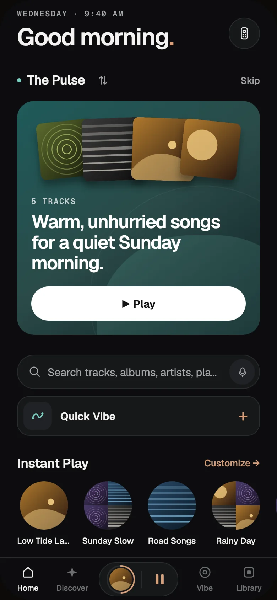
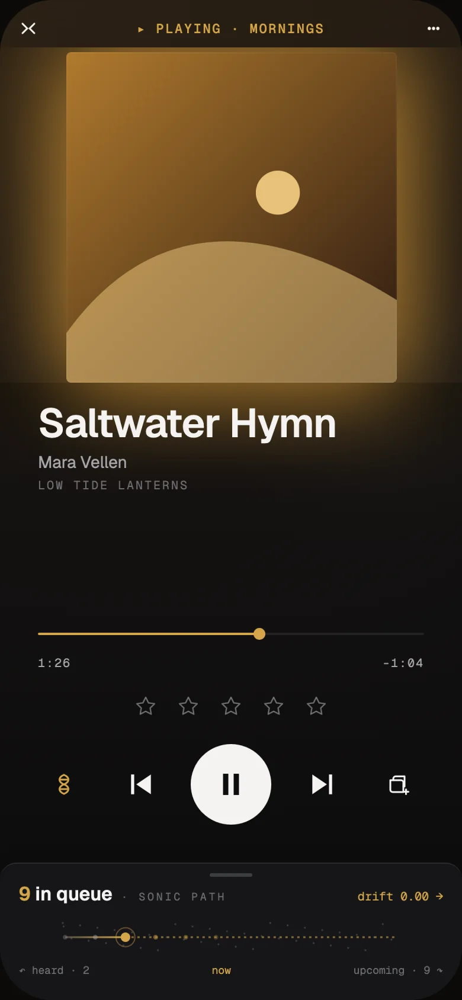
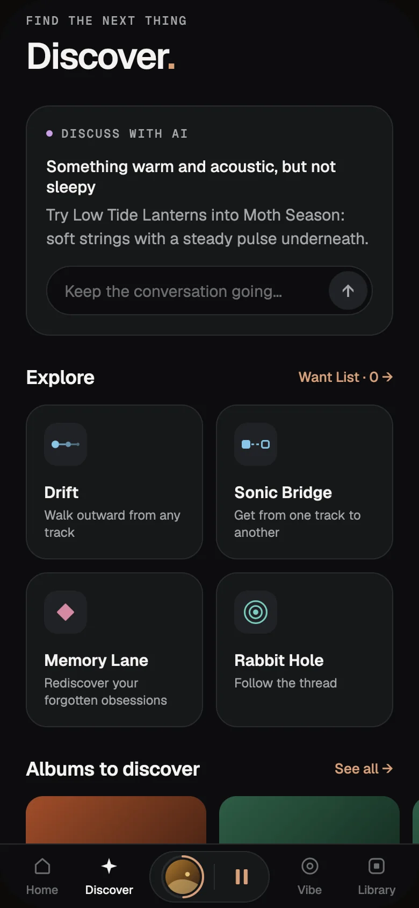
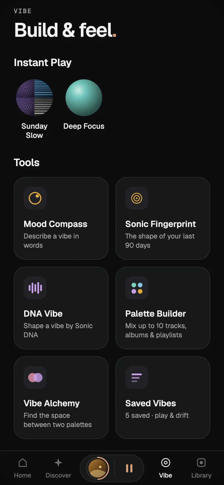
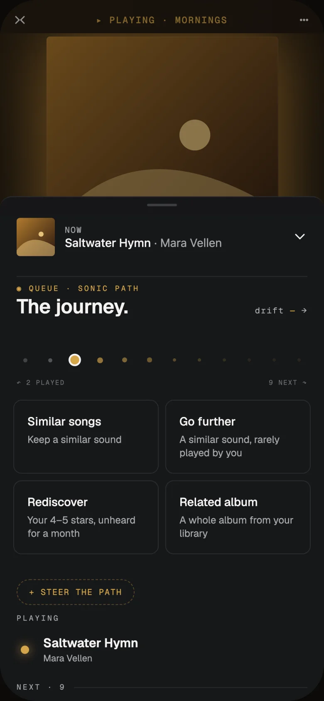
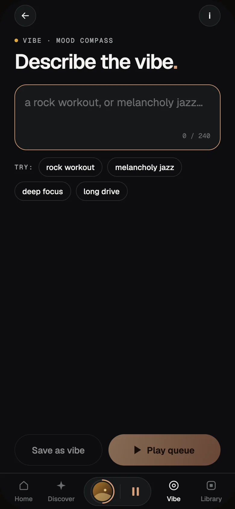
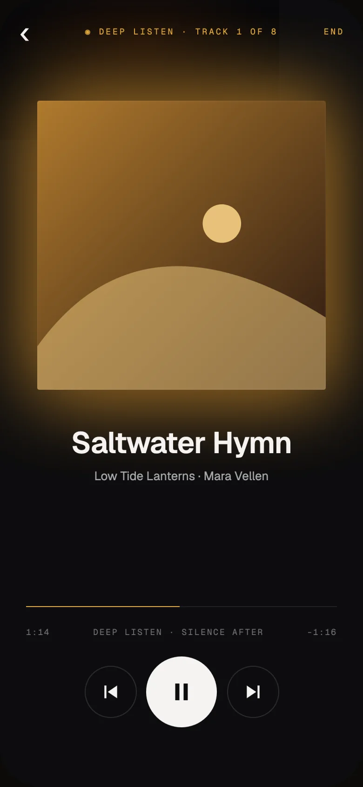
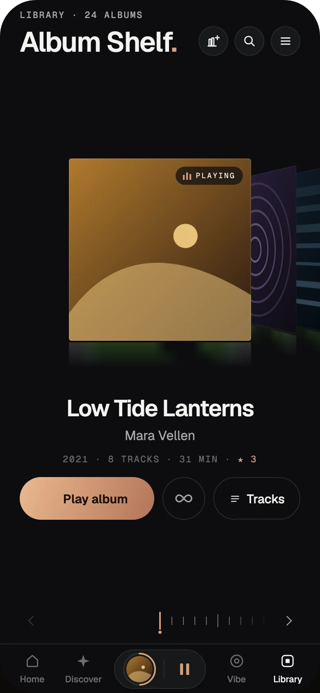

  

  <h1>Lumae</h1>

  
<strong>Rediscover the music you already own.</strong>

  

    A music player for Android and iPhone that knows how every song on your own
    music server sounds.
  

  
Android and iPhone beta · Navidrome or Jellyfin 12 · AudioMuse-AI

  

    <a href="https://lumaemusic.app/beta/"><strong>Join the beta</strong></a>
    ·
    <a href="https://lumaemusic.app">lumaemusic.app</a>
    ·
    <a href="#what-you-need">What you need</a>
    ·
    <a href="PRIVACY.md">Privacy</a>
    ·
    <a href="https://github.com/rendyhd/lumae/issues">Give feedback</a>
  

  
  
  
  

---

## Why Lumae

Your library is a landscape to explore, not a catalog to shuffle.

Most players give you a search box, a grid of albums and a shuffle button that
follows a whisper with a scream. Lumae starts somewhere else: with how your music
actually sounds. AudioMuse-AI listens to every track on your server once, and
Lumae uses that to build mixes that flow, queues that never jolt, and a way back
to albums you forgot you loved.

- **Your library is enough.** You already own more great music than you
  remember. Every mix, queue and suggestion starts from what is on your server.
- **Sequence matters.** Lumae never truly shuffles. Every mix, and every press of
  Shuffle, is ordered so each song leads into the next, like a set someone cared
  about.
- **Albums are art.** Play one from start to finish, in order, then take a moment
  to rate it. Album art comes first, always large.
- **Yours alone.** No account, no ads, no tracking. Your music stays on your
  server, and your taste is worked out on your phone.

## How it works

| Your music server | AudioMuse-AI | Lumae on your phone |
| --- | --- | --- |
| Navidrome or Jellyfin keeps your music, as it does today. Lumae streams and downloads from it and keeps ratings, plays and playlists in sync. | Listens to every track once and describes how it sounds: energy, mood, tempo, key and a 200-number summary of its sound. Lumae Analysis, Lumae's own plugin for AudioMuse-AI, gets that ready for your phone. | Syncs that description, then works out your mixes, queues and suggestions on the phone. The music streams straight from your server. |

There is no Lumae server in the middle, so nothing about your listening passes
through one.

## What it does

<table>
  <tr>
    <td width="50%" valign="top">
      <h3>Home: a mix for right now</h3>
      
<b>The Pulse</b> is one mix for this time of day and what you've been into lately. Shift it toward Calm, Mellow, Active or High. Below it: <b>Comfort mixes</b> from the music you keep returning to, <b>Suggested vibes</b> drawn from the sound of your library, and <b>Instant Play</b>, your twelve favorites one tap away.

    </td>
    <td width="50%" valign="top">
      <h3>Anti-shuffle, everywhere</h3>
      
Lumae places every song by how it sounds and walks between close neighbors, matching sound, energy, tempo and key. Mixes, Vibes and the Shuffle button on albums, artists, playlists and collections all play this way. Albums you press Play on stay in order, gapless.

    </td>
  </tr>
  <tr>
    <td valign="top">
      <h3>Every queue is a journey</h3>
      
Open the queue to see the sonic path ahead and change where it goes: <b>Similar songs</b>, <b>Go further</b> (a similar sound you rarely play), <b>Rediscover</b> (your 4–5★ songs, unheard for a month) or a <b>Related album</b>. Steer it brighter, darker, calmer or more intense, and undo any of it.

    </td>
    <td valign="top">
      <h3>Discover what you already have</h3>
      
<b>Drift</b> wanders twenty steps away from any song. <b>Sonic Bridge</b> finds a path between two. <b>Memory Lane</b> brings back songs you loved and stopped playing. <b>Rabbit Hole</b> builds a playlist pick by pick. <b>Discuss with AI</b> answers with songs from your library, each with a reason. <b>Albums to discover</b> suggests albums you don't own yet, once a day, if you turn it on.

    </td>
  </tr>
  <tr>
    <td valign="top">
      <h3>Build a mix around a feeling</h3>
      
<b>Mood Compass</b> takes a few words, like "rock workout" or "deep focus". <b>DNA Vibe</b> gives you ten sliders. <b>Palette Builder</b> blends up to ten tracks, albums and playlists. <b>Sonic Fingerprint</b> shows the shape of your last 90 days, and <b>Vibe Alchemy</b> finds the space between two Palettes. Saved Vibes play endlessly and follow you to your other phones.

    </td>
    <td valign="top">
      <h3>Sonic DNA</h3>
      
On Now Playing, tap Sonic DNA to see the song's ten traits. Pick the ones that got you, approve or reject each wave of matches, then play it or save it as a Palette.

    </td>
  </tr>
  <tr>
    <td valign="top">
      <h3>Deep Listen</h3>
      
Press Play album and Lumae gets out of the way: the album plays in order, without crossfades or loudness changes, and ends in a moment of silence. Then you rate it; give it five stars and Lumae offers a Rabbit Hole of its sonic neighbors. Ratings sync both ways with your music server.

    </td>
    <td valign="top">
      <h3>Your library, arranged your way</h3>
      
An <b>Album Shelf</b> you curate, with <b>Beyond your shelf</b> for albums you own but forgot. <b>Collections</b> of whole albums and single tracks. <b>Smart playlists</b> saved to your server. Artist pages with artists who sound alike, credits, live setlists, and covers from your own photos.

    </td>
  </tr>
  <tr>
    <td valign="top">
      <h3>Sound</h3>
      
<b>SmoothFade</b> times each crossfade to where one song really ends and the next really begins, using Lumae Analysis's measurements. Songs that follow each other on an album play gapless. Loud songs are leveled down, quiet ones never pushed up. <b>Buffer ahead</b> keeps the next songs whole on your phone. Android adds a parametric EQ with AutoEq import.

    </td>
    <td valign="top">
      <h3>Everywhere</h3>
      
Downloads, Smart downloads and a full library mirror for offline listening. <b>Android Auto</b> and <b>CarPlay</b>. Chromecast, AirPlay on iPhone, and Sonos and Marantz (HEOS) on Android. <b>Stealth mode</b> keeps a listen out of your history, taste and scrobbles. Dark and light themes.

    </td>
  </tr>
</table>

  
  
  
  

<em>Screens from the current design, shown with made-up music.</em>

## What's new

In the current beta:

- **Instant Play** (called Quick Launch in today's builds): up to twelve
  favorites on Home, in the Vibe tab and in the car, each with its own play
  options.
- **Custom and photo covers** for Vibes, collections and playlists, synced
  between phones.
- **A new look**: light and dark themes, new type, and a player in the tab bar.
- **Ratings sync both ways** with Navidrome; hearts count as four stars.
- **Albums to discover**: daily suggestions of albums you don't own yet, saved
  to your Want List.
- **Vibe sync**, **Buffer ahead**, **Resume last queue**, and crossfades that
  follow each song's measured ending.
- **CarPlay** in TestFlight.

With the current builds, 1.0.0 (32) on Android and (26) on iPhone (install
them from Google Play or TestFlight; an automatic update can't bring them):

- **Jellyfin 12.0+** as an alternative to Navidrome.
- **Lumae Radio**: find, adopt and control the radio from your phone.
- **Libraries**: switch your server's libraries on and off without a resync.
- **Home layout**: reorder or hide any section.
- **Up Next in the car**.
- **Search by Recording**: record about twenty seconds of a song playing nearby
  and find it in your library. Needs AudioMuse-AI 3.6.2 or newer with Neural
  Fingerprint turned on.

Not there yet: a sleep timer, playback speed, queue reordering, EQ on iPhone,
and search or Siri in CarPlay.

## What you need

| | |
| --- | --- |
| **Music server** | Navidrome, or Jellyfin 12.0 or newer. Other Subsonic servers, Plex, Emby and Lyrion aren't supported. A phone stays with the server type it was set up with. |
| **Sound analysis** | AudioMuse-AI 3.2 or newer with the latest **Lumae Analysis** plugin. Older plugin versions work with fewer features; Jellyfin needs 1.6.0 or newer. |
| **Phone** | Android 7.0 or newer, or an iPhone on iOS 16.4 or newer. Phones only, in portrait, in English for now. On iPhone, servers outside your home network need HTTPS. |
| **Optional** | An AI service (OpenAI, Anthropic, OpenRouter, or self-hosted like Ollama, Open WebUI or LM Studio) for chat, AI titles and album ideas; a Last.fm API key for album suggestions; Koito for your listening history. |

## Setup

1. **Install Lumae Analysis.** In AudioMuse-AI, open **Plugins** and install
   **Lumae Analysis** from the catalog. Turn on its collection manager if you want
   Collections, shelves, Vibes and covers to sync between phones.
2. **Join the beta.** Install Lumae with TestFlight on iPhone:
   [lumaemusic.app/beta](https://lumaemusic.app/beta/) shows how. Android is
   waiting for Google Play's review; sign up there and I'll email you when it
   opens. No server yet? Demo Mode lets you look around first.
3. **Connect.** Lumae asks for your AudioMuse-AI and music server, and checks
   both before it changes anything on your phone.
4. **Listen.** Your library is ready to browse as it arrives. A short guide shows
   you around while the sound analysis syncs.

Tip: if artists show album covers instead of photos, add `deezer` to Navidrome's
`ND_AGENTS`.

**Updating the beta:** install the newest build from TestFlight or Google Play
when it appears. Smaller fixes arrive by themselves: open Lumae, leave it open
for about 20 seconds, then close and reopen it.

## Lumae Radio

Lumae Radio turns a Raspberry Pi into an always-on radio for your home. It plays
stations made from your own music, follows the energy of your day, gives every song a rest before it comes back, and
is always in Stealth. It's in beta:
[install it from lumaemusic.app](https://lumaemusic.app/radio/#install), which
lists the checksums for the files on this repository's
[releases](https://github.com/rendyhd/lumae/releases).

## Privacy

Lumae has no account and no server of its own. Your library, listening history
and taste stay on your phone and on servers you run. AI, Koito and album
suggestions are off until you turn them on. The full
[privacy policy](PRIVACY.md) covers what goes where.

## Help shape Lumae

Tell me what Lumae recommended that felt surprisingly right, and what felt
repetitive, slow or confusing.

For problems, include your phone, your music server, AudioMuse-AI and Lumae
Analysis versions, your library's rough size, and what you were doing. In the app, **Library ≡ → Settings → About & help → Export diagnostic log**
saves a log with names, sign-ins
and addresses removed; please email it rather than posting it in a public issue.

**[Join the beta](https://lumaemusic.app/beta/)** ·
**[Open an issue](https://github.com/rendyhd/lumae/issues)** ·
**[apps@rendyjansen.com](mailto:apps@rendyjansen.com)**

---

> Lumae is an independent project, not an official AudioMuse-AI, Navidrome or
> Jellyfin client. Lumae app issues belong in this repository; confirmed
> AudioMuse-AI server or plugin-system issues belong in the AudioMuse-AI project.
