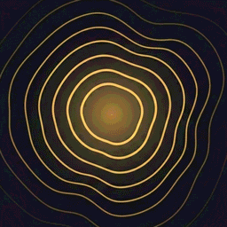
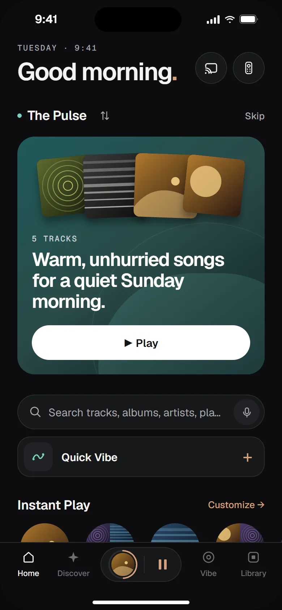
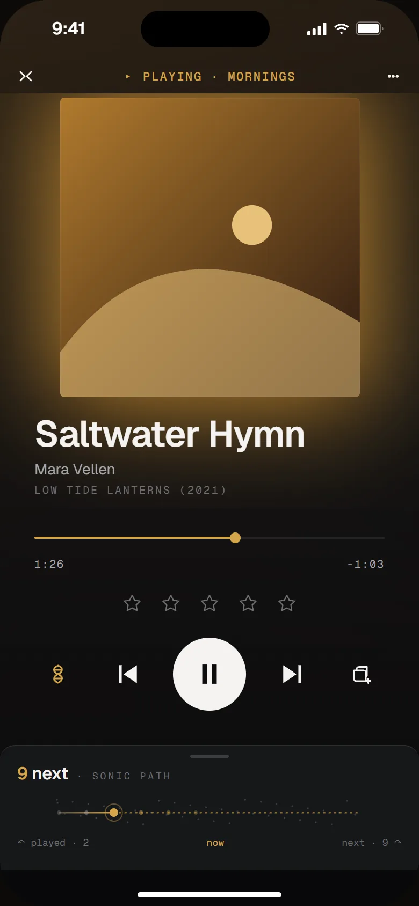
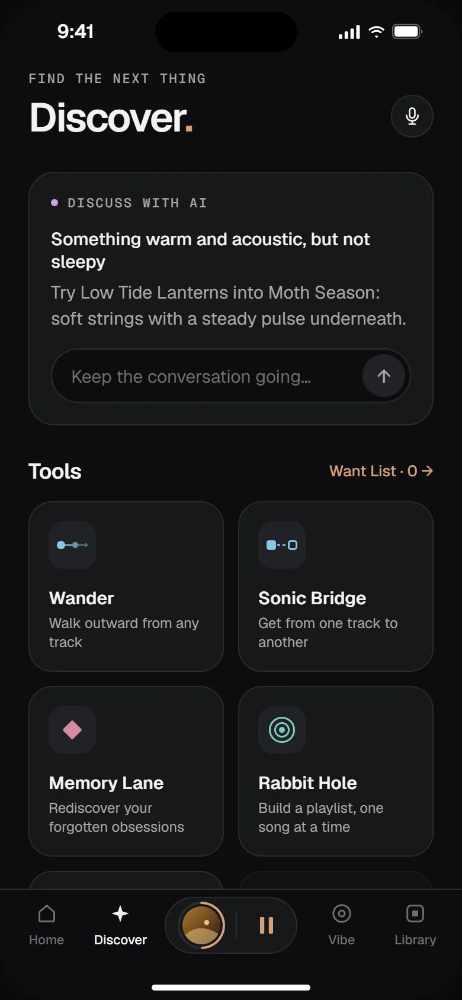
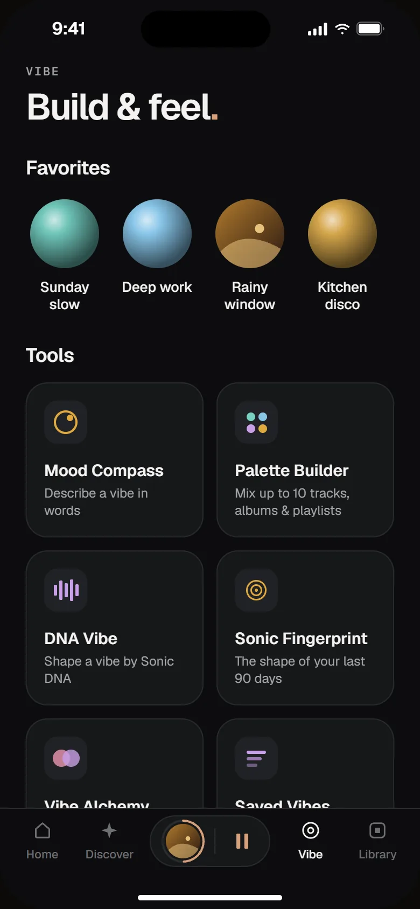
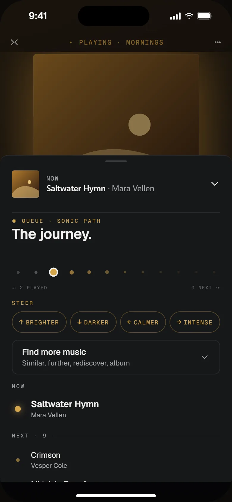
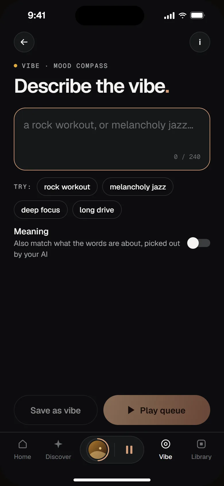
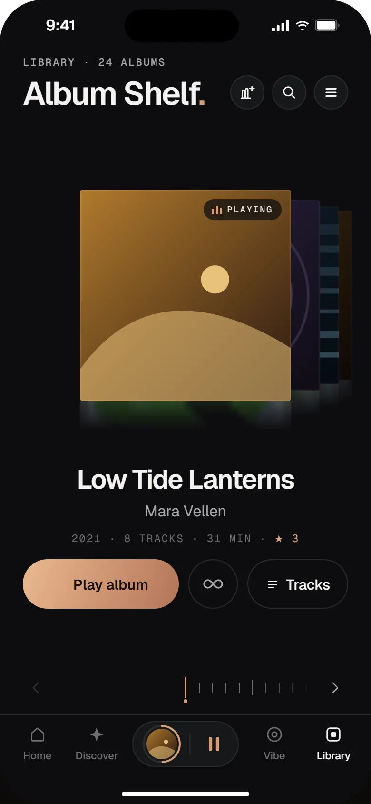
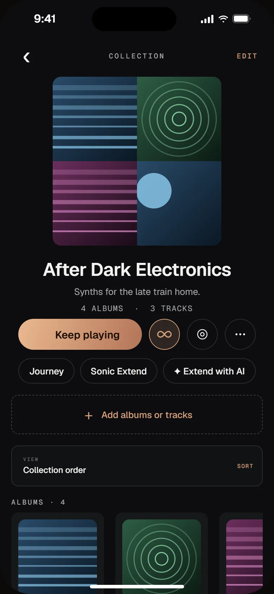

  

  <h1>Lumae</h1>

  
<strong>Rediscover the music you already own.</strong>

  

    A music player for Android and iPhone that knows how every song on your own
    music server sounds.
  

  
Android and iPhone beta · Navidrome or Jellyfin 12 · AudioMuse-AI

  

    <a href="https://lumaemusic.app/beta/"><strong>Join the beta</strong></a>
    ·
    <a href="https://lumaemusic.app">lumaemusic.app</a>
    ·
    <a href="#what-you-need">What you need</a>
    ·
    <a href="PRIVACY.md">Privacy</a>
    ·
    <a href="https://github.com/rendyhd/lumae/issues">Give feedback</a>
    ·
    <a href="https://ko-fi.com/rendyhd">Support on Ko-fi</a>
  

  
  
  
  

---

## Why Lumae

Your library is a landscape to explore, not a catalog to shuffle. AudioMuse-AI
listens to every track on your server once, and Lumae uses that to build mixes
that flow, queues that never jolt, and a way back to albums you forgot you
loved. It rests on three pillars:

- **Rediscover.** Find your way back into what you own: albums you forgot,
  five-star songs you haven't played in months.
- **Vibe.** Mixes built on how songs sound, not on genre tags. Name a feeling
  and every song leads into the next.
- **Library.** Albums as art. Play one start to finish, rate it, give it a
  place on your shelf.

Underneath all three, Lumae never truly shuffles: every song is placed so it
leads into the next.

## What it does

<table>
  <tr>
    <td width="50%" valign="top">
      <h3>Home: a mix for right now</h3>
      
<b>The Pulse</b> is one mix for this time of day and what you've been into lately; shift it toward Calm, Mellow, Active or High. Below it, <b>Comfort mixes</b> and <b>Suggested vibes</b>, and <b>Instant Play</b>: your twelve favorites one tap away. Open the queue to see the sonic path ahead and steer it toward <b>Similar songs</b>, <b>Go further</b>, <b>Rediscover</b> or a <b>Related album</b>.

    </td>
    <td width="50%" valign="top">
      <h3>Anti-shuffle, everywhere</h3>
      
Lumae places every song by how it sounds and walks between close neighbors, matching sound, energy, tempo and key. Mixes, Vibes and the Shuffle button on albums, artists, playlists and collections all play this way. Albums you press Play on stay in order, gapless.

    </td>
  </tr>
  <tr>
    <td valign="top">
      <h3>Discover what you already have</h3>
      
<b>Drift</b> wanders twenty steps away from any song. <b>Sonic Bridge</b> walks between two. <b>Memory Lane</b> brings back songs you loved and stopped playing. <b>Rabbit Hole</b> builds a playlist pick by pick. <b>Search by Recording</b> finds a song playing nearby in your library. With your own AI service, <b>Discuss with AI</b> answers with songs from your library and the <b>AI DJ</b> plans a whole set.

    </td>
    <td valign="top">
      <h3>Build a mix around a feeling</h3>
      
<b>Mood Compass</b> takes a few words, like "rock workout" or "deep focus". <b>DNA Vibe</b> gives you ten sliders. <b>Palette Builder</b> blends up to ten tracks, albums and playlists. <b>Sonic Fingerprint</b> and <b>Vibe Alchemy</b> play with the shape of your taste. Saved Vibes play endlessly and follow you to your other phones.

    </td>
  </tr>
  <tr>
    <td valign="top">
      <h3>Sonic DNA</h3>
      
On Now Playing, tap Sonic DNA to see the song's ten traits. Pick the ones that got you, approve or reject each wave of matches, then play it or save it as a Palette.

    </td>
    <td valign="top">
      <h3>Your library, arranged your way</h3>
      
An <b>Album Shelf</b> you curate, one album at a time, with <b>Beyond your shelf</b> for albums you own but forgot. <b>Collections</b> of whole albums and single tracks. <b>Smart playlists</b> saved to your server. Artist pages with artists who sound alike and credits. Ratings sync both ways with your music server.

    </td>
  </tr>
  <tr>
    <td valign="top">
      <h3>Sound</h3>
      
<b>SmoothFade</b> times each crossfade to where one song really ends and the next really begins. Songs that follow each other on an album play gapless. Loudness is leveled, and <b>Ease loud starts</b> brings a loud song in gently after a quiet ending. <b>Buffer ahead</b> keeps the next songs whole on your phone. Android adds a parametric EQ.

    </td>
    <td valign="top">
      <h3>Everywhere</h3>
      
Downloads, Smart downloads and a full library mirror for offline listening. <b>Android Auto</b> and <b>CarPlay</b>. Chromecast, AirPlay on iPhone, and on Android Sonos, Marantz (HEOS) and other <b>UPnP/DLNA</b> speakers. <b>Stealth mode</b> keeps a listen out of your history, taste and scrobbles.

    </td>
  </tr>
</table>

  
  
  
  

<em>Screens from the current design, shown with made-up music.</em>

## What's new

In the current builds, 1.0.0 (38) on Android and 1.0.0 (32) on iPhone from
Google Play and TestFlight, with their latest automatic update:

- **AI DJ**: tell it what the moment is, and it plans a set from your library
  and keeps it going. Talk to it from the queue as the set plays. Needs your own
  AI service.
- **Undertone**: focus, study and sleep music kept apart from your library, with
  presets, a timer and an alarm. Turn it on in Settings. The alarm needs Android,
  or an iPhone on iOS 26 or newer.
- **Lumae Radio widget** for your home screen: what the radio is playing, with
  Play/Pause, Next and Ban (on iPhone, iOS 17 or newer). Android also gets a Now
  playing widget for Lumae.
- **UPnP/DLNA speakers** on Android: TVs, streamers, receivers, Kodi.
- **Favorite speakers** at the top of Play on, and hidden ones out of the way.
- **Ease loud starts** (Settings → Sound): a loud song comes in gently after a
  quiet ending.

Smaller fixes arrive by themselves; see [Updating the beta](#setup).

Not there yet: a sleep timer for your library (Undertone has its own),
playback speed, queue reordering, EQ on iPhone, and search or Siri in CarPlay.

## How it works

| Your music server | AudioMuse-AI | Lumae on your phone |
| --- | --- | --- |
| Navidrome or Jellyfin keeps your music, as it does today. Lumae streams and downloads from it and keeps ratings, plays and playlists in sync. | Listens to every track once and describes how it sounds: energy, mood, tempo, key and a 200-number summary of its sound. Lumae Analysis, Lumae's own plugin for AudioMuse-AI, gets that ready for your phone. | Syncs that description, then works out your mixes, queues and suggestions on the phone. The music streams straight from your server. |

There is no Lumae server in the middle, so nothing about your listening passes
through one.

## What you need

| | |
| --- | --- |
| **Music server** | Navidrome, or Jellyfin 12.0 or newer. Other Subsonic servers, Plex, Emby and Lyrion aren't supported. A phone stays with the server type it was set up with. |
| **Sound analysis** | AudioMuse-AI 3.2 or newer with the latest **Lumae Analysis** plugin. Older plugin versions work with fewer features; Jellyfin needs 1.6.0 or newer. |
| **Phone** | Android 7.0 or newer, or an iPhone on iOS 16.4 or newer. Phones only, in portrait, in English for now. On iPhone, servers outside your home network need HTTPS. |
| **Optional** | An AI service (OpenAI, Anthropic, OpenRouter, or self-hosted like Ollama, Open WebUI or LM Studio) for chat, the AI DJ, AI titles and album ideas; a Last.fm API key for album suggestions; Koito for your listening history. |

## Setup

1. **Install Lumae Analysis.** In AudioMuse-AI, open **Plugins** and install
   **Lumae Analysis** from the catalog. Turn on its collection manager if you want
   Collections, shelves, Vibes and covers to sync between phones.
2. **Join the beta.** Install Lumae with TestFlight on iPhone, or from Google
   Play on Android after joining the beta group:
   [lumaemusic.app/beta](https://lumaemusic.app/beta/) shows how. No server
   yet? Demo Mode lets you look around first.
3. **Connect.** Lumae asks for your AudioMuse-AI and music server, and checks
   both before it changes anything on your phone.
4. **Listen.** Your library is ready to browse as it arrives. A short guide shows
   you around while the sound analysis syncs.

Tip: if artists show album covers instead of photos, add `deezer` to Navidrome's
`ND_AGENTS`.

**Behind a reverse proxy?** If AudioMuse-AI sits behind a proxy with its own
sign-in (Traefik forward auth, Authelia, Authentik and the like), let these paths
through without that sign-in. AudioMuse-AI still checks Lumae's own login on each
of them. A blocked path answers with the proxy's sign-in page, and Lumae says
"Couldn't ask AudioMuse-AI".

| Path | Method | Used for |
| --- | --- | --- |
| `/auth` | POST | Signing in with a username and password |
| `/api/sync` | GET | Syncing the sound analysis |
| `/api/models` | GET | Which analyses AudioMuse-AI has run (lyrics, neural fingerprints) |
| `/api/version` | GET | AudioMuse-AI's version, for Search by Recording |
| `/api/lyrics/search/text` | POST | Search by meaning: Mood Compass, Discover chat and Search |
| `/api/lyrics/warmup` | POST | Loading the lyrics model before a meaning search |
| `/api/recording_search/search` | POST | Search by Recording |
| `/api/recording_search/warmup` | POST | Loading the recording model before a search |
| `/plugins/lumae_analysis/api/*` | GET, POST | Lumae Analysis: catalog, profiles, collections, covers, shelves, Vibes and journeys |

**Updating the beta:** install the newest build from TestFlight or Google Play
when it appears. Smaller fixes arrive by themselves: open Lumae, leave it open
for about 20 seconds, then close and reopen it.

## Lumae Radio

Lumae Radio turns a Raspberry Pi into an always-on radio for your home. It plays
stations made from your own music, follows the energy of your day, gives every song a rest before it comes back, and
is always in Stealth. It's in beta:
[install it from lumaemusic.app](https://lumaemusic.app/radio/#install), which
lists the checksums for the files on this repository's
[releases](https://github.com/rendyhd/lumae/releases).

## Privacy

Lumae has no account and no server of its own. Your library, listening history
and taste stay on your phone and on servers you run. AI, Koito and album
suggestions are off until you turn them on. The full
[privacy policy](PRIVACY.md) covers what goes where.

## Help shape Lumae

Tell me what Lumae recommended that felt surprisingly right, and what felt
repetitive, slow or confusing.

For problems, include your phone, your music server, AudioMuse-AI and Lumae
Analysis versions, your library's rough size, and what you were doing. In the app, **Library ≡ → Settings → About & help → Export diagnostic log**
saves a log with names, sign-ins
and addresses removed; please email it rather than posting it in a public issue.

**[Join the beta](https://lumaemusic.app/beta/)** ·
**[Open an issue](https://github.com/rendyhd/lumae/issues)** ·
**[Support on Ko-fi](https://ko-fi.com/rendyhd)** ·
**[apps@rendyjansen.com](mailto:apps@rendyjansen.com)**

---

> Lumae is an independent project, not an official AudioMuse-AI, Navidrome or
> Jellyfin client. Lumae app issues belong in this repository; confirmed
> AudioMuse-AI server or plugin-system issues belong in the AudioMuse-AI project.
